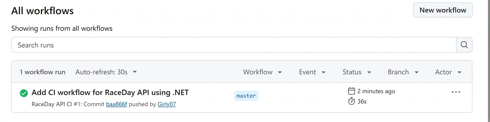

# RaceDay API - PROG6212 Part 2

**Student Name:** Girly Mamane Mashilo
**Student Number:** ST10475571
**Module:** PROG6212

## Project Overview
This is the RESTful API backend for the RaceDay system. It handles user authentication, event management, participant enrolments, and race results. Built using ASP.NET Core Web API, Entity Framework Core (Code-First), and SQL Server.

## The Two Roles
1. **Organiser:** Can create, update, and delete events. Can define categories for events. Can view all enrolments and capture race results.
2. **Participant:** Can view events and categories. Can enrol in specific event categories. Can view their own enrolments and personal race results.

## Setup and Run Instructions
1. **Prerequisites:** Visual Studio 2022, .NET 8 SDK, SQL Server Express/LocalDB.
2. **Clone the repository:**
   ```bash
   git clone https://github.com/Girly07/RaceDay-PART2.git


 **PART 3**

   # RaceDay Platform - Part 3 (Automation of Web Application)

## 📌 Project Overview
This repository contains the final submission for the RaceDay platform (PROG6212). It consists of a RESTful API (developed in Part 2) and a new ASP.NET Core MVC Web Application (developed in Part 3). 

The MVC application serves as the frontend for the platform, providing a clean, role-aware interface for both **Organisers** and **Participants**.

## 🏗️ Architecture & Structure
The solution strictly adheres to the requirement that the MVC project must not have direct database access or replicated business logic.

*   **RaceDay.API**: The backend Web API. It handles Entity Framework Core database operations, session-based authentication, business logic, and Azure Blob Storage integration.
*   **RaceDay.MVC**: The frontend Web Application. It communicates *exclusively* with the API via `HttpClient` (using the `ApiService` class). It manages user roles and states using local session cookies.
*   **RaceDay.Tests**: The unit testing project for the API.

## ✨ Key Features Implemented
*   **Session-Based Authentication:** Secure login and registration handled via the API, with the MVC app maintaining the authenticated state and roles.
*   **Role-Based Navigation:** Distinct UI and navigation menus for Organisers and Participants.
*   **Organiser Dashboard:** Create events, manage categories, view total enrolments, and capture race results.
*   **Participant Interface:** Browse and filter events, enrol in specific categories, view personal race history/results, and update profiles.
*   **Azure Blob Storage:** Event banner images and user profile pictures are uploaded via the API to Azure Blob Storage (with mock fallback for local testing).
*   **Docker Containerisation:** The entire application is containerised for consistent deployment.

## 🚀 How to Run Locally (Without Docker)
1. Clone the repository and open `RaceDaySolution.sln` in Visual Studio.
2. Ensure your database is up to date by running the following in the Package Manager Console (select `RaceDay.API` as the default project):
   ```bash
   Update-Database
