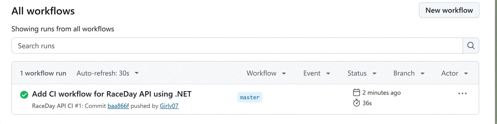

# RaceDay API - PROG6212 Part 2

**Student Name:** Girly Mamane Mashilo
**Student Number:** ST10475571
**Module:** PROG6212

## Project Overview
This is the RESTful API backend for the RaceDay system. It handles user authentication, event management, participant enrolments, and race results. Built using ASP.NET Core Web API, Entity Framework Core (Code-First), and SQL Server.

## The Two Roles
1. **Organiser:** Can create, update, and delete events. Can define categories for events. Can view all enrolments and capture race results.
2. **Participant:** Can view events and categories. Can enrol in specific event categories. Can view their own enrolments and personal race results.

## Setup and Run Instructions
1. **Prerequisites:** Visual Studio 2022, .NET 8 SDK, SQL Server Express/LocalDB.
2. **Clone the repository:**
   ```bash
   git clone https://github.com/Girly07/RaceDay-PART2.git
